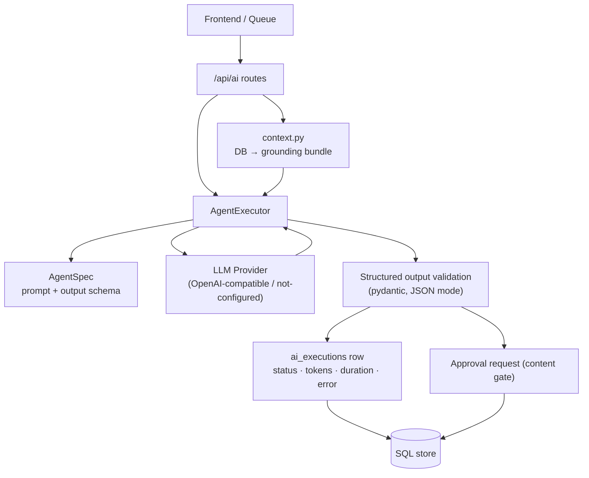

# AI Agent Architecture

Seven specialized agents coordinated through one provider-agnostic executor.
No agent is a large autonomous loop — each run is a context retrieval + one or
two validated LLM calls. Deterministic work (weekly review, extraction,
status transitions) runs in plain service functions and never calls the LLM.

## Agent registry

| Agent | Role | Output schema | Approval gate |
|---|---|---|---|
| executive-assistant | Primary user-facing agent; retrieval, delegation, synthesis | `ExecutiveAssistantOut` | No |
| business-analyst | Health reports, insights, opportunities | `BusinessAnalystOut` | No |
| project-manager | Progress, blockers, deadline risks, next actions | `ProjectManagerOut` | No |
| client-intelligence | Client summaries, outstanding commitments, follow-ups | `ClientIntelligenceOut` | No |
| content | Content ideas, briefs, drafts | `ContentOut` | **Yes** (drafts await review) |
| financial-analyst | Revenue, expense, invoice, trend analysis | `FinancialAnalystOut` | No |
| research | Research briefs from source-backed inputs | `ResearchOut` | No |

## Architecture



## Context retrieval

`ai/context.py` builds a grounding bundle from the database: business profile
(counts, month income/expense/net), active projects, overdue/pending tasks,
recent activity, overdue invoices, recent reports, and — when specified —
targeted project/client context. Every number an agent reports comes from this
bundle; agents are instructed never to invent figures.

## Structured output

Every agent declares a pydantic output model. The provider is asked for a JSON
object matching the schema (JSON mode + the schema embedded in the prompt). The
executor parses the response (tolerating markdown fences), validates against
the output model, and logs success/failure. Validation failures never produce
silent fallback text — the execution is logged as `failed` with the reason.

## Provider abstraction

```python
class LLMProvider(Protocol):
    @property
    def is_configured(self) -> bool: ...
    async def complete(self, system, user, **kwargs) -> LLMResult: ...
```

Implemented providers:

- `OpenAICompatibleProvider` — works with OpenAI, Groq, Mistral, Ollama, vLLM,
  LM Studio, or any OpenAI-compatible `/chat/completions` endpoint.
- `NotConfiguredProvider` — raises a `NotConfiguredError`; the API surfaces it
  as an explicit 503. No fake outputs exist anywhere.

## Human approval gate

Consequential outputs (content drafts, publishes, deletes, sends) go through
`approval_requests`. The `content` agent returns `awaiting_approval`; the draft
is saved to `content_items` only after the user resolves the approval.
Resolving an approval with `approved` triggers the side effect; `rejected`
records the reason. The frontend exposes the queue at `/ai` (Approvals tab).

## What is not automated

- Publishing content (requires human click — by design).
- Sending emails/messages (no sender is configured by default).
- Destructive operations (deletes are soft — `status="archived/churned/void"`).

## Execution log

Every run is logged: agent, provider, model, token counts, duration, status,
error. Never logged: secrets, raw credentials, full prompts with user data
(input is logged as a shallow dict).
