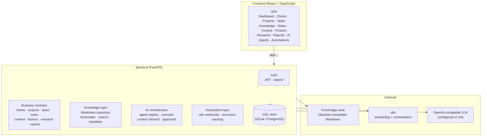
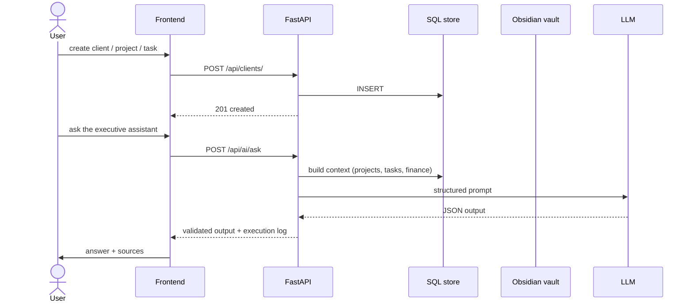

# System Architecture

Business OS is a **modular monolith**: one FastAPI API + one React SPA + one
Markdown vault + optional n8n. The domain logic lives in the API (`app/`) and
never in the frontend or the vault. The Markdown vault is the durable memory;
PostgreSQL/SQLite is the authoritative structured store.

## High-level diagram



## Layering rules

| Rule | Why |
|---|---|
| All file I/O goes through `knowledge/repository.py` | One choke point for path safety and traversal protection |
| All external LLM calls go through `ai/providers.py` | No provider-specific code in business modules |
| Structured transactional data lives in the DB | Single source of truth, joins, transactions |
| Long-form text lives in the vault | Human-editable, portable, Obsidian-compatible |
| Automation is external (n8n) | Do not reimplement n8n; track executions, trigger webhooks |
| Nothing publishes or sends without human approval | Approval manager gates consequential AI actions |

## Data flow



## Module boundaries

```
app/
├── config.py          Settings (pydantic-settings, .env)
├── database.py        SQLAlchemy engine/session
├── models.py          normalized schema (22 tables)
├── schemas.py         API contracts (pydantic)
├── auth.py            argon2 + JWT
├── deps.py            auth dependency + activity logging
├── securityutil.py    path safety, frontmatter, link extraction
├── knowledge/         vault repository — the only code touching the vault
├── ai/                providers, agents, context, approvals
├── automation/        n8n client + execution tracking
└── routers/           auth, clients, projects, tasks, knowledge,
                   daily notes, content, finance, research,
                   reports, dashboard, ai, automation, queue
```

## Authoritative sources

- **PostgreSQL/SQLite:** users, clients, projects, milestones, tasks, task dependencies,
  meetings, transactions, invoices, research documents, reports, AI executions, approvals,
  automation workflows/executions, queue requests, activity logs.
- **Markdown vault:** notes, meeting write-ups, content drafts, research briefs, daily notes
  (with lightweight DB mirror of metadata). The DB mirrors titles/paths, never the content.

## Deviations from the spec

1. **SQLite for local development** instead of PostgreSQL — Docker is unavailable in this
   sandbox; PostgreSQL is supported via `DATABASE_URL` (documented, untested here).
2. **No Redis/Celery** — the queue executes synchronously inside the request cycle with an
   explicit status lifecycle; n8n is the async/scheduled engine.
3. **No separate frontend host server** — Vite dev server in dev, nginx in prod.
4. **`packages/` monorepo split** — collapsed to a single FastAPI package; the modular
   structure is preserved via clearly separated `app/` packages. This keeps imports simple
   and avoids cross-package builds without a real benefit.
